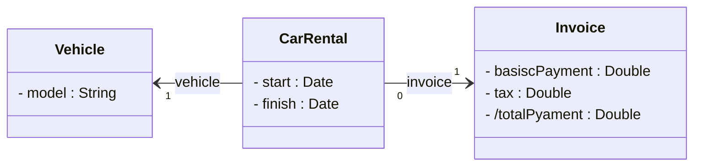
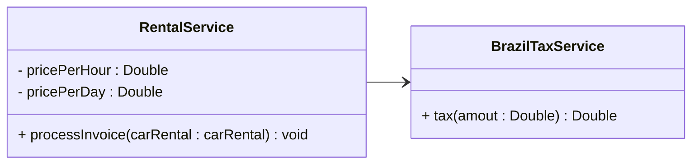

Uma locadora brasileira de carros cobra um valor por hora para alocações até 12 horas. Porém, se a duração da locadora ultrapassar 12 horas, a locação será cobrada com base em um valor diário. Além do valor da locação, é acrescido no preço o valor do imposto conforme regras do país que, no caso so Brasil, é 20% para valores até 100.00 ou 15% para valores acima de 100.00. Fazer um programa que lê os dados da locação (modelo do carro, instante inicial e final da locação), bem como o valor por hora e o valor diário de locação. Programa deve então gerar a nota de pagamento (contendo o valor da locação, o valor do imposto e valor total do pagamento) e informar os dados na tela 

Service layer design (no interface)

